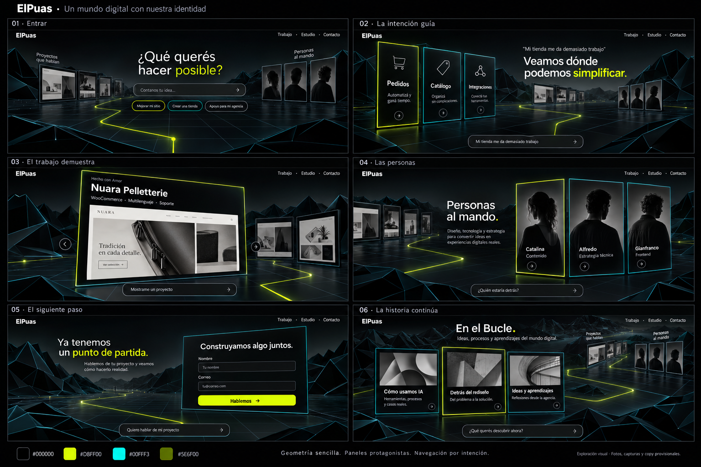
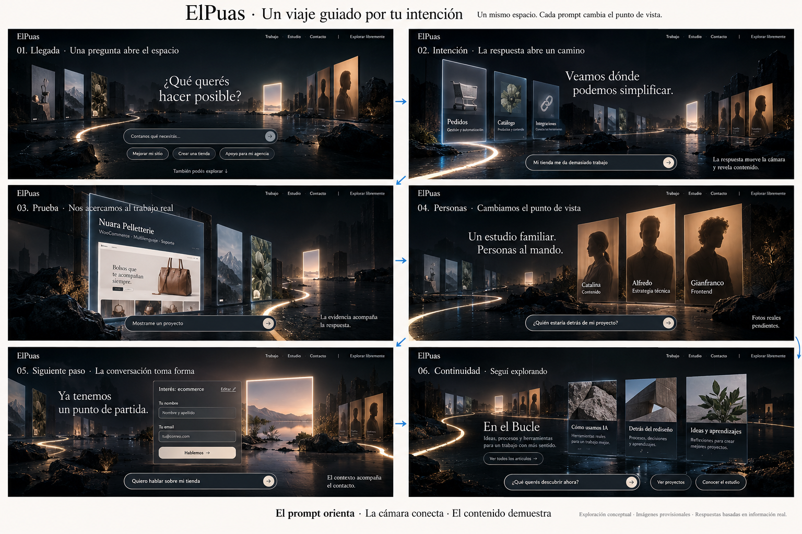
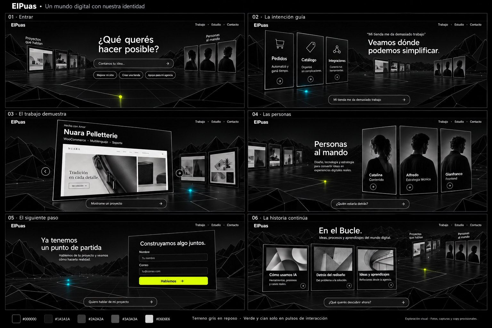

# Storyboard and environments

## Current hybrid exploration

This is a concept image, not actual screenshots or people. Reuse layout rhythm and atmosphere, not fabricated products, portraits or copy. Terrain and panels can use simple geometry; real content remains HTML and images.

## Original atmosphere reference

Keep depth, panel prominence and continuous landmarks. Do not reproduce detailed rocks, reflections or costly textures literally.

## Alternative restraint study

Alfredo preferred the first colored variant after seeing this alternative. Keep this as a comparison, not the canonical target.

## Flow

1. Arrival: a question and suggested intents. The world and destinations are faintly visible.
2. Intent: authored response reveals relevant capabilities and initiates a camera transition.
3. Work: approach a real project panel; allow opening its preserved case-study page.
4. Studio: move toward real team photos and factual roles.
5. Contact: stable readable form; never submit until backend and consent behavior exist.
6. Continue: editorial panels lead to preserved blog articles.

The same environment persists. Prompts change camera destination, not random page backgrounds. Stabilize the camera for reading and interaction. First milestone: arrival → intent → one actual project.
